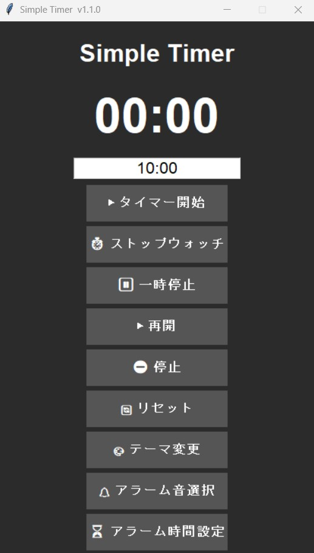

# ⏱ Simple Timer

## 🇯🇵 日本語

**Simple Timer** は、Windows向けのシンプルで使いやすいタイマー・ストップウォッチアプリです。

### ✨ 主な機能

- ⏱ タイマー
- ⏲ ストップウォッチ
- ▶️ 開始・一時停止・再開・停止・リセット
- 🌙 ライトテーマ・ダークテーマ対応
- 🔔 WAV・MP3ファイルをアラーム音として設定可能
- ⏳ アラーム再生時間を5～30秒で設定可能
- ⚡ 軽量で高速
- 💻 Windows 10 / Windows 11 対応

### 📸 スクリーンショット

### 📦 インストール

1. **Releases**ページから最新版をダウンロードします。
2. **SimpleTimer_Setup_v1.1.exe** を実行します。
3. インストールウィザードに従ってセットアップしてください。

### 🚀 使い方

1. タイマーまたはストップウォッチを選択します。
2. 必要に応じて時間を設定します。
3. テーマやアラーム音を自由に変更できます。
4. **開始**ボタンをクリックします。
5. タイマー終了時に設定したアラーム音が再生されます。

### 💻 動作環境

- Windows 10
- Windows 11

---

## 🇺🇸 English

**Simple Timer** is a simple and easy-to-use timer and stopwatch application for Windows.

### ✨ Features

- ⏱ Timer
- ⏲ Stopwatch
- ▶️ Start, Pause, Resume, Stop, and Reset
- 🌙 Light and Dark theme support
- 🔔 Custom alarm sounds (WAV and MP3)
- ⏳ Adjustable alarm duration from 5 to 30 seconds
- ⚡ Lightweight and fast
- 💻 Supports Windows 10 / Windows 11

### 📸 Screenshot

### 📦 Installation

1. Download the latest release from the **Releases** page.
2. Run **SimpleTimer_Setup_v1.1.exe**.
3. Follow the installation wizard.

### 🚀 How to Use

1. Choose **Timer** or **Stopwatch** mode.
2. Set the desired time if using the timer.
3. Customize the theme and alarm sound if needed.
4. Click **Start**.
5. The selected alarm sound will play when the timer finishes.

### 💻 Requirements

- Windows 10
- Windows 11

## 📄 License

This project is licensed under the MIT License.

## 👨‍💻 Author

Created by **Matsuri-code**

## ☕ Support

If you enjoy using **Simple Timer**, you can support future development here:

☕ https://ko-fi.com/matsuricode

Thank you for your support!

